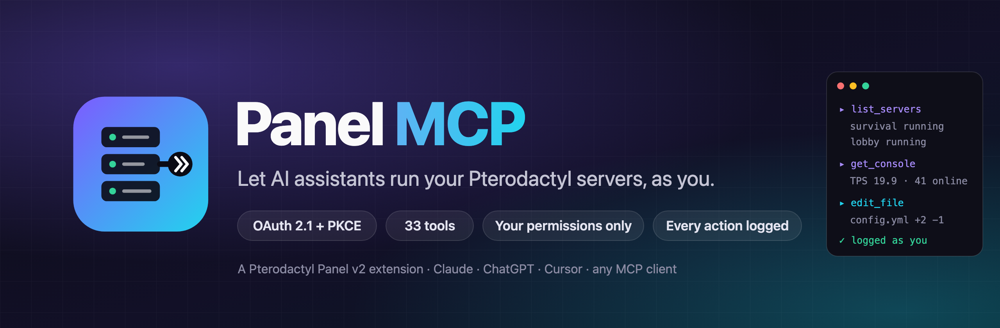
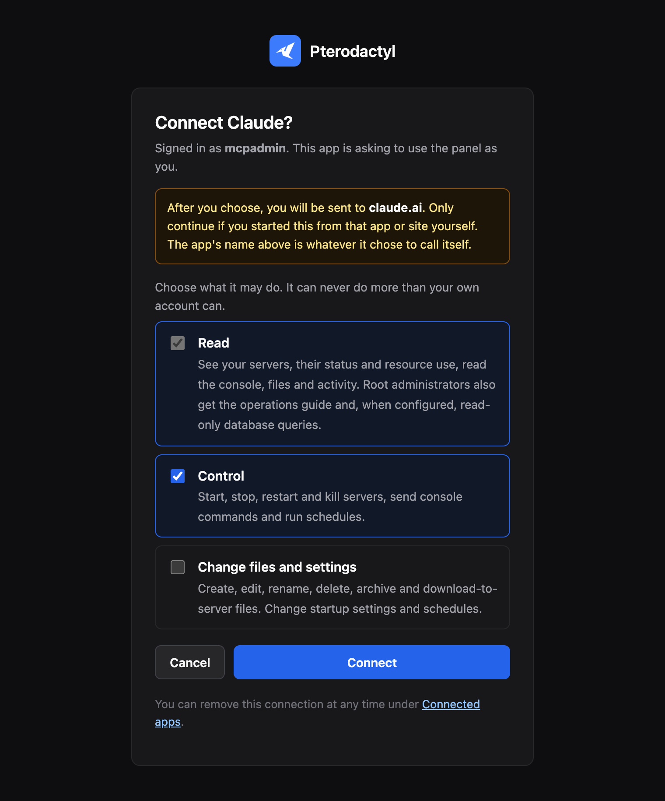
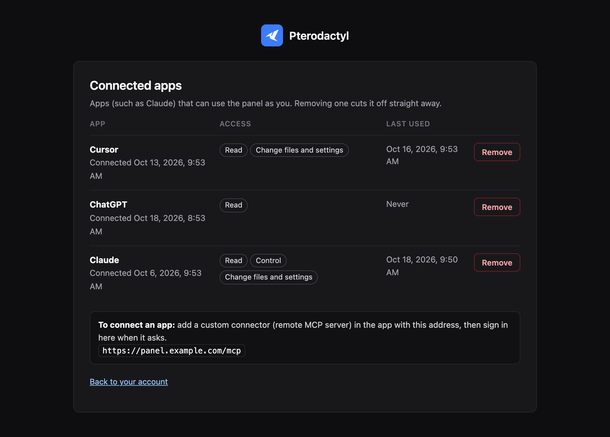
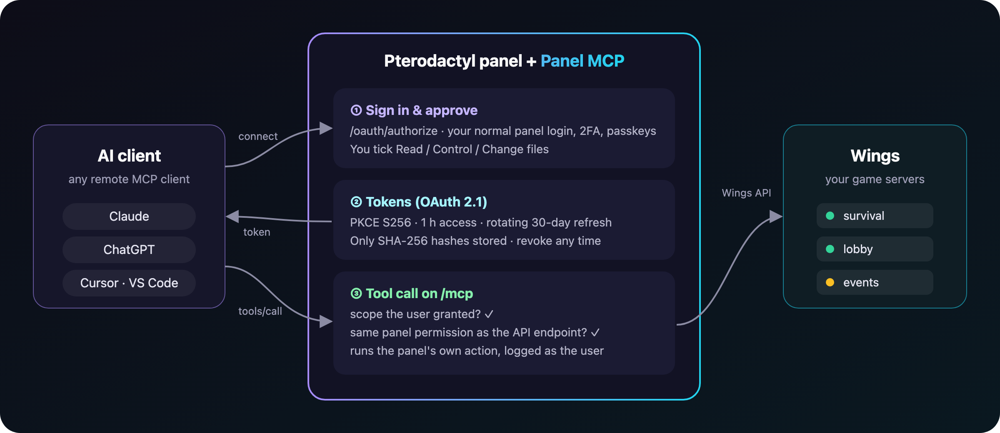
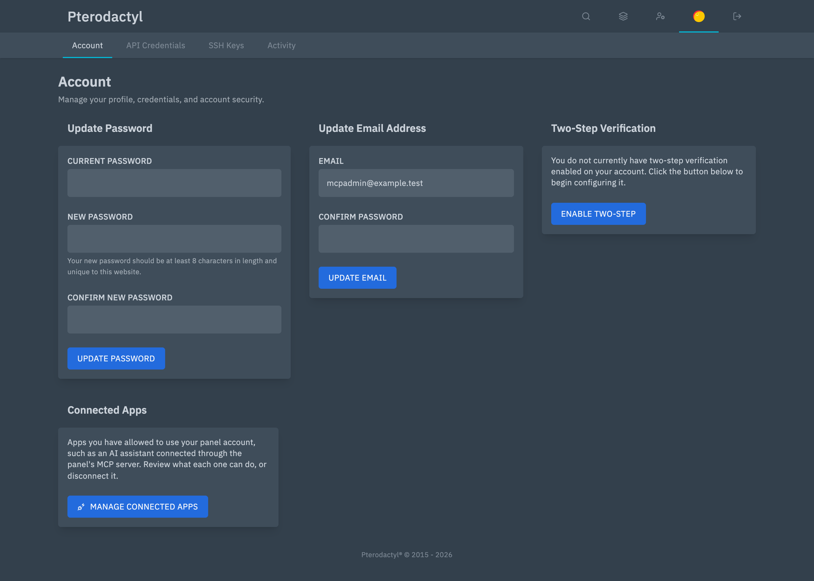

<p align="center">
  
</p>

<p align="center">
  <a href="https://github.com/jackh54/pterodactyl-panel-mcp/releases/latest"></a>
  
  
  
  <a href="LICENSE"></a>
</p>

<p align="center">
  <b>Panel MCP</b> is a Pterodactyl Panel extension that puts an <a href="https://modelcontextprotocol.io">MCP</a> server inside your panel.<br>
  Connect Claude, ChatGPT, Cursor or any MCP client with your normal panel sign-in, and let it read consoles,<br>
  edit configs, restart servers and manage schedules, with exactly the permissions your account already has.
</p>

<p align="center">
  <a href="#-install">Install</a> ·
  <a href="#-connect-an-ai-client">Connect a client</a> ·
  <a href="#-tools">Tools</a> ·
  <a href="#-security">Security</a> ·
  <a href="#%EF%B8%8F-configuration">Configuration</a> ·
  <a href="#-add-your-own-tools">Extend it</a>
</p>

---

## ✨ Why

Running game servers means a lot of small, careful jobs: *"why did the lobby crash at 3am?"*, *"bump view-distance on survival and restart it after the countdown"*, *"which plugin is spamming this error?"*. Panel MCP lets an AI assistant do those jobs **through your panel**, not around it:

- **No API keys to paste anywhere.** The client signs in with OAuth 2.1, the same way you sign in to the panel (password, 2FA, passkeys), and you pick what it may do on a consent screen.
- **Never more than you.** Every tool checks the same panel permission as the matching API endpoint. A subuser with console-only access gets console-only tools.
- **Everything on the record.** Each action lands in the panel's activity log **once, as you**, under the panel's own event names. It reads exactly like your own clicks.
- **One click to cut it off.** Account → Connected Apps lists every app with its access and last use. Remove one and its tokens die instantly.
- **Runs in the panel process.** No extra service, port, container or database: install the extension and add the URL to your client.

<p align="center">
  
  &nbsp;
  
</p>

## 🧭 How it works

<p align="center">
  
</p>

1. Your MCP client finds the authorization server through `/.well-known/oauth-protected-resource` and registers itself (dynamic client registration).
2. You sign in to the panel and approve the connection on a consent page that shows **where you will be sent back to** and lets you choose **Read**, **Control** and **Change files and settings**.
3. The client receives an access token (1 hour) and a rotating refresh token (30 days) and calls tools on `/mcp` (Streamable HTTP, JSON responses).
4. Each tool call is checked against the scopes you granted **and** your panel permissions, then runs through the panel's own action classes, so anything that hooks those actions (other extensions, activity logging) sees MCP calls too.

## 📦 Install

> [!IMPORTANT]
> Panel MCP is an extension for **Pterodactyl Panel v2** (the `2.0-develop` branch and its extension SDK). It does not run on 1.x.

**From a release (recommended).** Download `panel-mcp.pteroext` from the [latest release](https://github.com/jackh54/pterodactyl-panel-mcp/releases/latest), then on the panel host:

```bash
cd /var/www/pterodactyl
php artisan p:extension:install /path/to/panel-mcp.pteroext --enable
```

That runs the extension's migration (four `ext_panel_mcp_oauth_*` tables) and publishes its frontend. Reload the panel in your browser.

**From source.** Build it against your panel's SDK (from a panel checkout where `npm ci && npm run build` has run):

```bash
git clone https://github.com/jackh54/pterodactyl-panel-mcp.git && cd pterodactyl-panel-mcp
mkdir -p .sdk && (cd /path/to/panel/packages/sdk && npm pack --pack-destination "$OLDPWD/.sdk")
mv .sdk/pterodactyl-sdk-*.tgz .sdk/pterodactyl-sdk.tgz
npm install && npm run build && npm test
cd /var/www/pterodactyl
php artisan p:extension:pack /path/to/pterodactyl-panel-mcp --output=/tmp/panel-mcp.pteroext
php artisan p:extension:install /tmp/panel-mcp.pteroext --enable
```

**Behind nginx**, make sure `/.well-known/` requests reach PHP (the stock Pterodactyl nginx config already sends everything that is not a file to `index.php`). Behind Cloudflare or another proxy, keep request timeouts at 100 seconds or more: `wait_for_console` waits up to 90.

## 🔌 Connect an AI client

Your MCP server URL is your panel address plus `/mcp`:

```text
https://panel.example.com/mcp
```

| Client | Where to add it |
|---|---|
| **Claude** (claude.ai, Desktop, mobile) | Settings → Connectors → *Add custom connector* → paste the URL |
| **Claude Code** | `claude mcp add --transport http panel https://panel.example.com/mcp` |
| **ChatGPT** | Settings → Connectors (developer mode) → add a custom connector with the URL |
| **Cursor** | `~/.cursor/mcp.json` → `{"mcpServers": {"panel": {"url": "https://panel.example.com/mcp"}}}` |
| **VS Code** | Command palette → *MCP: Add Server* → HTTP → paste the URL |
| **Anything else** | Any client that supports remote MCP servers with OAuth |

The client opens your panel, you sign in (if you aren't already) and approve. Connections show up under **Account → Connected Apps**.

<p align="center">
  
</p>

## 🧰 Tools

50 built-in tools. Each one needs the scope shown **and** the panel permission the equivalent API endpoint requires. Admin tools only exist for root administrators; nobody else even sees them listed.

<table>
<tr><th>Read</th><th>Control</th></tr>
<tr valign="top"><td>

`list_servers` · servers you can see, with live state<br>
`get_server` · details, limits, allocations, variables, image choices<br>
`get_console` · recent console output<br>
`wait_for_console` · wait for a line (e.g. `Done (`)<br>
`list_files` · `read_file` · `search_files`<br>
`download_file` · any file, base64 or a link<br>
`inspect_archive` · look inside a jar/zip, read `plugin.yml`, outline a `.class`<br>
`list_schedules` · `get_activity`<br>
`list_backups` · `download_backup` · a short-lived link<br>
`list_allocations` · ports and their notes<br>
`list_databases` · passwords only with Manage access<br>
`get_ops_guide` 🛡️ · your team's runbook<br>
`query_database` 🛡️ · read-only SQL

</td><td>

`power_action` · start, stop, restart, kill<br>
`send_command` · run a console command and return the new output<br>
`run_schedule` · trigger a schedule now<br>
`create_backup` · with a name, lock and ignore patterns

</td></tr>
<tr><th>Change files and settings</th><th>Manage backups, ports and databases</th></tr>
<tr valign="top"><td>

`edit_file` · exact search-and-replace edits<br>
`write_file` · `create_folder`<br>
`rename_file` · `copy_file` · `delete_files`<br>
`compress_files` · `decompress_file`<br>
`pull_file` · download a URL to the server<br>
`upload_file` · any file up to 4 MB<br>
`create_upload_link` · for bigger files<br>
`set_startup_variable` · `set_docker_image`<br>
`save_schedule` · `delete_schedule`<br>
`save_schedule_task` · `delete_schedule_task`<br>
`update_server_config` 🛡️ · limits, startup, image

</td><td>

`restore_backup` · over the files, or onto a clean server<br>
`delete_backup` · `set_backup_lock`<br>
`add_allocation` · `update_allocation` · `remove_allocation`<br>
`create_database` · returns the details for a plugin config<br>
`rotate_database_password` · `delete_database`<br>
`rename_server` · `reinstall_server`

</td></tr>
</table>

🛡️ = root administrators only. `query_database` exists only when you configure a read-only database account; `get_ops_guide` answers once you install a guide.

**Manage backups, ports and databases** arrived in 1.1. Connections approved before that don't have it: remove the app under Connected Apps and connect again to tick the box. On panel builds older than an action a tool needs, that tool is simply not listed.

Every client also receives short **instructions** when it connects: read before changing, confirm before restarts or deletes, never run a plugin's reload command, never echo secrets. Add your own house rules under **Admin → Extensions → Panel MCP**.

## 🔒 Security

Panel MCP was written to be safe to point an AI at a production network.

| | |
|---|---|
| **Authorization** | OAuth 2.1 with mandatory PKCE (S256), exact redirect URI matching, RFC 8707 `resource` checks, dynamic client registration for public clients only. |
| **Consent** | Only from a real panel session (password + 2FA or passkey), CSRF protected, single use, and it names the site you will be sent back to, because client names are self-chosen. |
| **Tokens** | Random, stored only as SHA-256 hashes, bound to one connection. Codes live 2 minutes and work once; reusing a code revokes the connection. Refresh tokens rotate, and replaying an old one after a short retry window revokes the connection. |
| **Permissions** | A scope can only narrow what your account can already do. Tools run the panel's own permission checks for the server and action, and refuse suspended servers. The panel's "require 2FA" setting applies to MCP connections too. Database passwords are only returned to connections with Manage access, for accounts the panel would show them to. |
| **Isolation** | `/mcp` takes bearer tokens only: no cookies, no session, no CSRF surface, so a signed-in browser tab can't drive it. Per-connection rate limit (120 requests/minute by default). Backup restores, new ports and new databases also count against the panel's own per-server limits, shared with clicks in the panel. |
| **Audit** | Every change is written to the activity log as the user who connected; a connection email goes to the account owner; connections and removals are logged too. |
| **Files** | Path traversal is refused; uploads report size and SHA-256; overwrites need an explicit `overwrite: true`; request bodies are read raw so file contents are never altered by input middleware. |
| **SQL** | `query_database` uses a separate database account you create with SELECT only, plus a statement filter, a read-only transaction and a 15-second limit. Point it at game or plugin databases, never at the panel's own. |

Found a vulnerability? Please read [SECURITY.md](SECURITY.md) and report it privately.

## ⚙️ Configuration

Everything is optional. Settings go in the panel's `.env` (then `php artisan config:clear`).

| Variable | Default | What it does |
|---|---|---|
| `PANEL_MCP_OPS_GUIDE_PATH` | `storage/app/panel-mcp/ops-guide.md` | Markdown file served by `get_ops_guide`. Install one with `php artisan panel-mcp:guide /path/to/guide.md`. |
| `PANEL_MCP_SQL_HOST` / `_PORT` | `127.0.0.1` / `3306` | Database server for `query_database`. |
| `PANEL_MCP_SQL_USERNAME` / `_PASSWORD` | *(empty = tool off)* | A **SELECT-only** account. |
| `PANEL_MCP_SQL_DATABASES` | | Comma-separated databases the tool may query. |
| `PANEL_MCP_BRAND_ICON` | the panel's favicon | Icon on the consent and Connected Apps pages. |
| `PANEL_MCP_REQUESTS_PER_MINUTE` | `120` | Per-connection rate limit. |
| `PANEL_MCP_TABLE_PREFIX` | `ext_panel_mcp_` | Prefix of the four OAuth tables. Only change it before installing, or to reuse tables from an earlier install. |

In the admin area, **Extensions → Panel MCP → Assistant** holds extra instructions sent to every client.

### The operations guide

Give your AI the same runbook your staff use. Write it as Markdown with numbered `##` sections:

```markdown
## 1. Ground rules
## 4. Restarts
## 7. Dangerous commands
```

Install it with `php artisan panel-mcp:guide ops-guide.md`. Clients are told to read it before changing anything; they can list the sections, open one (`section: "4"`), or search it. Never put passwords, tokens or keys in it.

### Read-only SQL

```sql
CREATE USER 'panel_mcp_ro'@'127.0.0.1' IDENTIFIED BY 'a-long-random-password';
GRANT SELECT ON `luckperms`.* TO 'panel_mcp_ro'@'127.0.0.1';
GRANT SELECT ON `litebans`.* TO 'panel_mcp_ro'@'127.0.0.1';
```

```dotenv
PANEL_MCP_SQL_USERNAME=panel_mcp_ro
PANEL_MCP_SQL_PASSWORD=a-long-random-password
PANEL_MCP_SQL_DATABASES=luckperms,litebans
```

## 🧩 Add your own tools

Other extensions can add tools to the MCP server. Implement `PanelMcp\Contracts\ProvidesTools` and tag the class:

```php
use PanelMcp\Contracts\ProvidesTools;
use Pterodactyl\Models\User;

class NetworkTools implements ProvidesTools
{
    public function tools(): array
    {
        return [
            'get_player_count' => [
                'scope' => 'panel:read',
                'admin' => false,
                'title' => 'Player count',
                'description' => 'Players online across the network right now.',
                'properties' => [],
                'required' => [],
                'run' => fn (array $args, User $user, object $grant) => ['online' => 42],
            ],
        ];
    }
}
```

```php
// In your extension provider's register() or boot():
$this->app->tag([NetworkTools::class], 'panel-mcp.tools');
```

Tagging only stores the class name, so your extension keeps working when Panel MCP isn't installed. Built-in tool names win (unless this panel build can't offer that built-in), malformed tools are skipped and logged, and your tool does its own permission checks (throw `PanelMcp\ToolException` to return an error).

## 🧪 Development

```bash
npm install && npm run build   # frontend (Connected Apps card)
npm test && npx tsc            # unit tests and types
php tests/upstream-classes.php ../panel   # every panel class the extension uses still exists
```

`tests/e2e` holds an end-to-end suite of about 530 checks that drives the OAuth flow and every tool over real HTTP against a **local** dev panel with a fake Wings node. See [tests/e2e/README.md](tests/e2e/README.md).

## 📄 License

[MIT](LICENSE) © PandaScript. Not affiliated with or endorsed by Pterodactyl Software.

<p align="center"><sub>Looking for a standalone MCP server for Pterodactyl 1.x that uses API keys? See <a href="https://github.com/jackh54/pterodactyl-mcp">jackh54/pterodactyl-mcp</a>.</sub></p>
